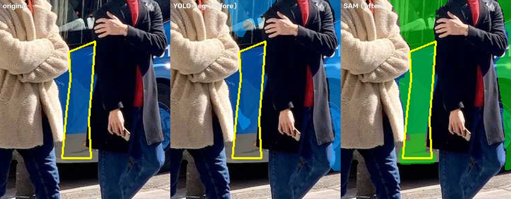
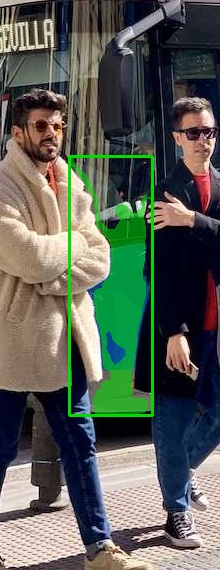

# YOLO 보완 PoC — 탐지 결과의 "놓침"을 다른 AI로 메우기

지난 과제에서 만든 「작은 YOLO 서비스」에는 약점이 세 가지 있었습니다. 작은 물체를 놓치고, 가려진 물체의 마스크에 구멍이 나고, 원본 대조를 전부 눈으로 해야 했습니다. 이 PoC는 **약점마다 맞는 AI를 한 단계씩 덧붙여서** 실제로 나아지는지 확인합니다.

## 0. 무엇을 보완했나 — 지난 과제와 나란히

> **비교 대상(기존 방식): [YOLO-assignment 저장소](https://github.com/s1004sb/YOLO-assignment)** — 지난 과제에서 만든 「작은 YOLO 서비스」입니다.
> 이 저장소는 그 서비스의 원본 대조 기록에서 나온 약점을 출발점으로 삼았습니다. 지난 과제의 코드와 결과는 고치지 않고 그대로 두었습니다.

| | 지난 과제 (기존 방식) | 이번 PoC (보완) | 달라진 점 |
|---|---|---|---|
| 저장소 | [YOLO-assignment](https://github.com/s1004sb/YOLO-assignment) | 이 저장소 | |
| 쓰는 AI | `yolo26n` + `yolo26n-seg` 2개 | 거기에 `yolo26m`, YOLOE(글자 지목), SAM 2.1을 덧붙여 5개 | 약점마다 맞는 모델을 한 단계씩 추가 |
| 약점 1: 작은 물체 놓침 | 휴대폰을 못 찾음 (대조 기록 #2) | 넥타이는 새로 찾음(10개 중 8 → 9개). **휴대폰은 여전히 못 찾음** | 절반만 해결 |
| 약점 2: 가려진 물체 마스크 누락 | 두 사람 사이 버스 옆면이 빠짐 (대조 기록 #1) | 그 틈을 덮은 비율 5.6% → **89.3%** | 해결 |
| 약점 3: 원본 대조를 눈으로 | 사진을 확대해 가며 5곳을 직접 짚음 | 모델끼리 다른 곳 5–6곳을 `report.html` 로 자동 정리 | 볼 곳을 좁혀 줌 (시간은 미측정) |
| 결과물 | 박스·마스크 그림, JSON | 그것에 더해 검토 목록, 기존 대비 비교 숫자 | |

지난 과제 README의 「6. 원본 대조 기록」에 적힌 #1(버스 옆면 누락)과 #2(휴대폰)가 이번 PoC의 정답 목록과 실험 대상이 되었습니다.

| 문서 | 내용 |
|---|---|
| [문제정의서.md](문제정의서.md) | 도메인, 현재의 문제, 개선 가설, 대상 사용자, 성공 기준 |
| [검증결과.md](검증결과.md) | 기존 방식과의 비교 숫자, 실패 사례, 한계와 다음 단계 |
| `poc.py` | PoC 본체 (입력 → AI 처리 → 결과 출력) |
| `evaluate.py` | 정답 목록으로 기존 방식과 비교 |

## 1. 결과 먼저

**마스크 구멍 메우기 (가장 큰 성과)** — 두 남자 사이로 보이는 버스 옆면(노란 선)을 기존 마스크는 5.6%만 덮었고, SAM은 89.3%를 덮었습니다.



**검토 목록** — 사진 전체를 훑는 대신 모델끼리 결과가 다른 곳만 잘라서 보여 줍니다. 아래는 PoC가 스스로 짚은 "마스크 구멍일 수 있는 곳"입니다. 지난 과제에서 눈으로 찾았던 바로 그 자리입니다.



| 가설 | 기존 방식 | 보완 방식 | 판정 |
|---|---|---|---|
| A. 작은 물체 다시 찾기 | 정답 10개 중 8개 | 9개 (오탐 2개 늘어남) | 턱걸이 통과, **휴대폰은 실패** |
| B. 마스크 구멍 메우기 | 5.6% | 89.3% | 통과 |
| C. 사람이 볼 곳 줄이기 | 사진 전체 | 사진당 5–6곳 | 부분 통과 (시간 미측정) |

**정직하게**: 원래 가장 찾고 싶었던 손에 든 휴대폰은 다섯 가지 방법을 써도 못 찾았습니다. 자세한 내용은 [검증결과.md](검증결과.md)의 실패 사례에 있습니다.

## 2. 실행 방법 (처음 받은 사람 기준)

Windows PowerShell, Python 3.12 기준입니다. GPU는 필요 없습니다.

```powershell
# 1) 가상환경 만들기 + 설치 (처음 한 번)
python -m venv .venv
.venv\Scripts\python.exe -m pip install torch torchvision --index-url https://download.pytorch.org/whl/cpu
.venv\Scripts\python.exe -m pip install -r requirements.txt

# 2) 모델 받기 (처음 한 번, 약 500MB) — 공식 출처에서 받고 지문(SHA256)을 자동으로 대조합니다
.venv\Scripts\python.exe download_models.py --with-text-encoder

# 3) 샘플 사진 준비 — 인터넷이 아니라 설치된 패키지에서 예제 2장을 복사합니다
.venv\Scripts\python.exe prepare_samples.py

# 4) PoC 실행 → outputs/poc/사진이름/report.html 을 브라우저로 열어 보세요
.venv\Scripts\python.exe poc.py

# 5) 검증 실행 → 기존 방식과 비교한 표가 출력되고 outputs/eval/ 에 저장됩니다
.venv\Scripts\python.exe evaluate.py
```

- 내 사진으로 해 보려면 `data/samples/` 에 사진을 넣고 4)를 다시 실행하거나, `poc.py --images 내사진.jpg --prompts "cell phone" "cup"` 처럼 실행합니다.
- 글자로 찾는 단계가 필요 없으면 `requirements.txt` 의 `clip` 이하 4줄을 지우고 2)에서 `--with-text-encoder` 를 빼면 됩니다. 그 단계만 자동으로 건너뜁니다.
- 실행 시간은 CPU에서 사진 1장에 7–18초입니다(첫 장은 모델을 읽느라 더 걸립니다).

## 3. 동작 흐름

```
사진 ─▶ ① 기준선     yolo26n / yolo26n-seg          기존 서비스가 하던 일
        ├▶ ② 큰 YOLO   yolo26m                        기준선이 놓친 물체 후보
        ├▶ ③ 글자 지목  YOLOE + "cell phone" 같은 글자   이름을 지목해서 다시 찾기
        ├▶ ④ SAM       기준선 박스 → 윤곽 다시 따기      마스크 구멍 메우기
        └▶ ⑤ 검토 목록  ①과 ②③④가 다른 곳만 모음        report.html + result.json
```

사진마다 `outputs/poc/사진이름/` 에 아래 파일이 생깁니다.

| 파일 | 내용 |
|---|---|
| `report.html` | 확인할 곳 목록(잘라 본 그림, 이유, 맞음/아님 칸), 마스크 비교 표 |
| `result.json` | 단계별 결과(클래스, 점수, 좌표), 처리 시간 — 다른 프로그램에서 읽을 수 있음 |
| `1_baseline.jpg`, `2_3_helpers.jpg` | 기준선 박스 / 보조 모델이 추가로 가리킨 곳 |
| `1_baseline_mask.jpg`, `4_sam_mask.jpg` | 기존 마스크 / SAM 마스크 |
| `candidates/c00.jpg …` | 확인할 곳을 하나씩 잘라 낸 그림 |

## 4. 모델을 고른 이유

| 단계 | 고른 모델 | 이유 | 비교한 다른 후보 |
|---|---|---|---|
| ① 기준선 | `yolo26n`, `yolo26n-seg` | 기존 서비스와 같은 모델이어야 "기존 방식"과 공정하게 비교됨 | — |
| ② 큰 YOLO | `yolo26m` (640) | conf 0.10에서 놓친 넥타이를 찾음. 사진당 약 0.9초 | `yolo26s`: 결과가 n과 같아 보조 역할을 못 함 / 1280 해상도: 오히려 사람을 놓침 |
| ③ 글자 지목 | `yoloe-26s-seg` + MobileCLIP2 | 찾을 대상을 글자로 바꿀 수 있음. 640·conf 0.10에서 9/10, 오탐 2개로 가장 균형이 좋았음 | YOLO-World: 추가 프로그램이 더 필요해 제외 / 1280: 오탐 급증 |
| ④ 마스크 | `sam2.1_t` (SAM 2.1 tiny) | YOLO 박스만 넘기면 윤곽을 다시 따 줌. CPU에서 5초 안팎 | `sam_b`(358MB): CPU에서 너무 느릴 것으로 보여 받지 않음 / YOLO-seg만 쓰기: 틈을 5.6%만 덮음 |

모두 **내 컴퓨터 CPU에서 무료로** 돌아가고 사진이 밖으로 나가지 않는다는 점을 우선했습니다. 숫자 근거는 [검증결과.md](검증결과.md) 2–3장에 있습니다.

## 5. 안전하게 받고 실행하기

| 한 일 | 내용 |
|---|---|
| 공식 출처만 사용 | 모델은 Ultralytics 공식 자료 저장소(`ultralytics/assets` v8.4.0)에서만 받음 |
| 지문 대조 | `download_models.py` 가 받은 직후 SHA256을 공식 값과 대조하고, 다르면 지우고 멈춤. 결과는 `models/MODELS.json` 에 기록 |
| 숨은 자동 설치 끄기 | `poc.py` 가 `YOLO_AUTOINSTALL=False` 로 실행해, 실행 중 인터넷에서 무언가를 몰래 설치하지 못하게 함 |
| 추가 프로그램 고정 | 글자 지목 단계에 필요한 `clip` 은 내용을 검토한 버전(커밋)으로 고정 |
| 사진 | 인터넷에서 받지 않고 설치된 패키지의 예제를 복사. 실제 인물이 나온 `zidane.jpg` 와 그 결과 그림은 저장소에 올리지 않음 |

`.pt` 모델 파일은 여는 순간 안의 코드가 실행될 수 있는 형식입니다. 출처를 모르는 `.pt` 파일은 이 PoC에 넣지 마세요.

## 6. 파일 구조

```
YOLO보완PoC/
├─ 문제정의서.md / 검증결과.md / README.md
├─ poc.py               PoC 본체
├─ evaluate.py          개선 효과 검증
├─ download_models.py   모델 받기 + 지문 대조
├─ prepare_samples.py   샘플 사진 준비
├─ requirements.txt
├─ data/
│  ├─ samples/          bus.jpg (zidane.jpg 는 prepare_samples.py 로 복사)
│  ├─ ground_truth.json 사람이 확인하는 정답 목록
│  └─ SOURCES.json      사진 출처
├─ models/              MODELS.json (모델 파일은 올리지 않음)
└─ outputs/
   ├─ poc/              사진별 report.html, result.json, 그림
   └─ eval/             eval.json, 비교 그림
```

## 7. 라이선스와 출처

- Ultralytics(YOLO, YOLOE, SAM 실행 코드와 모델)는 **AGPL-3.0** 입니다. 과제·학습용으로는 괜찮습니다. 서비스로 공개 배포하려면 소스 공개 의무를 지키거나 별도 라이선스가 필요합니다.
- 사진 출처는 [`data/SOURCES.json`](data/SOURCES.json) 에 적었습니다.
