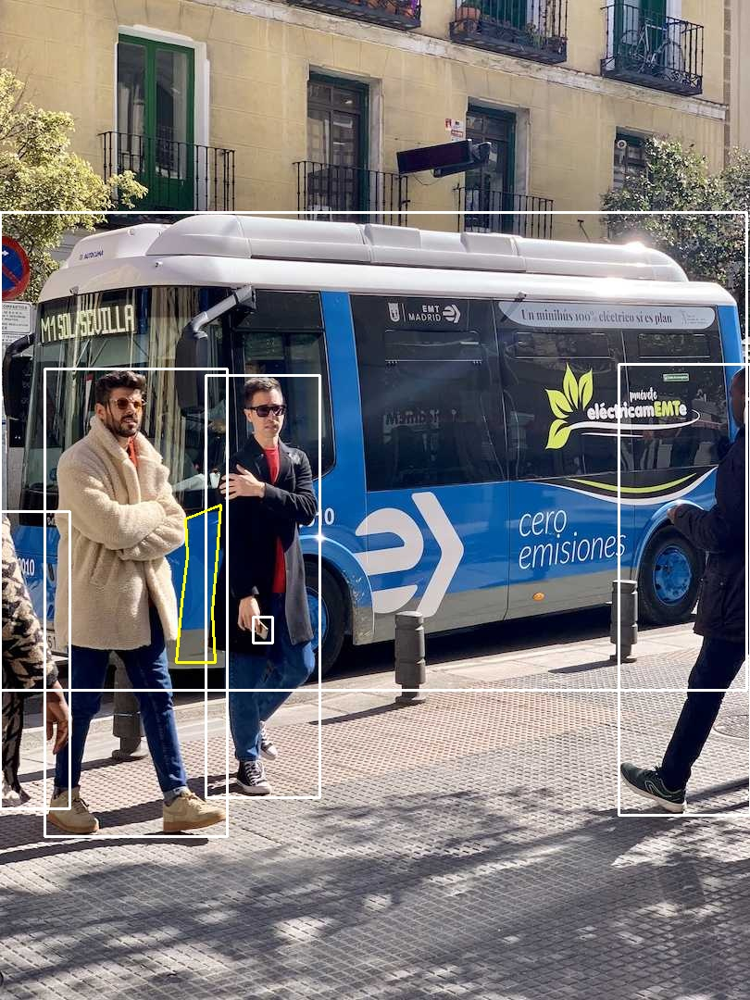
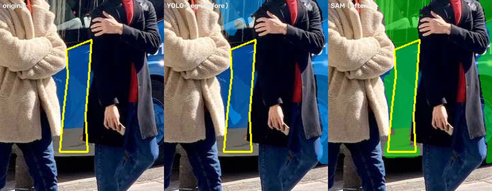

# 개선 효과 검증 결과

> 측정일 2026-11-17 · 내 컴퓨터(CPU) · 샘플 사진 2장(bus, zidane) · 정답 물체 10개
> 기존 방식 = 지난 과제 [YOLO-assignment](https://github.com/s1004sb/YOLO-assignment) 와 같은 모델·설정(`yolo26n`, 640, conf 0.25)
> 숫자는 모두 `python evaluate.py` 가 만든 [`outputs/eval/eval.json`](outputs/eval/eval.json) 에서 옮겼습니다.

## 0. 한눈에 보기

| 가설 | 기존 방식 | 보완 방식 | 성공 기준 | 판정 |
|---|---|---|---|---|
| **A. 작은 물체 다시 찾기** | 10개 중 8개 찾음, 오탐 0 | 10개 중 **9개**, 오탐 2 (YOLOE 640, conf 0.10) | 놓친 것의 절반 이상 회복, 오탐 사진당 1개 이하 | **턱걸이 통과 / 원래 목표(휴대폰)는 실패** |
| **B. 마스크 구멍 메우기** | 가려진 틈의 **5.6%** 덮음 | SAM으로 **89.3%** 덮음 | 기존의 2배 이상 | **통과** (약 16배) |
| **C. 사람이 볼 곳 줄이기** | 사진 전체를 눈으로 훑기 | 사진당 **5–6곳**만 확인. 놓친 2개 중 1개가 목록에 들어옴 | 놓친 대상이 목록에 있고 시간 절반 이하 | **부분 통과** (시간은 아직 안 잼) |
| **공통. 처리 시간** | 약 0.4초 | 사진당 7–18초 | 30초 이내 | **통과** |

가장 큰 성과는 B(마스크), 가장 큰 실패는 **휴대폰을 끝내 못 찾은 것**입니다.

## 1. 정답 목록은 어떻게 만들었나

- 원본을 확대해 보고 물체 10개의 위치를 [`data/ground_truth.json`](data/ground_truth.json) 에 적었습니다.
  bus.jpg: 버스 1, 사람 4, 휴대폰 1 / zidane.jpg: 사람 2, 넥타이 2
- 기존 모델이 놓친 것은 **휴대폰**(bus)과 **오른쪽 남자의 어두운 넥타이**(zidane) 2개입니다.
- 마스크용 정답은 "두 남자 사이로 보이는 버스 옆면"을 다각형 하나로 그렸습니다(5,929px).
- ⚠️ 좌표는 AI가 원본을 보고 잡은 **대략값**입니다. `outputs/eval/gt_bus.jpg` 로 그려 두었으니 사람이 한 번 더 확인해야 합니다.

## 2. 가설 A — 작은 물체 다시 찾기

| 방식 | 찾음 | 잘못 찾음 | 사진당 시간 | 놓친 것 |
|---|---|---|---|---|
| **기존: yolo26n, 640, conf 0.25** | 8/10 | 0 | 0.14s | 휴대폰, 넥타이② |
| yolo26n, **1280** | 7/10 | 2 | 0.51s | 휴대폰, 넥타이②, **사람 1명(새로 놓침)** |
| yolo26**s**, 640 | 8/10 | 0 | 0.30s | 휴대폰, 넥타이② |
| yolo26**m**, 640 | 8/10 | 0 | 0.82s | 휴대폰, 넥타이② |
| yolo26m, 640, **conf 0.10** | **9/10** | 3 | 0.89s | 휴대폰 |
| yolo26m, 1280, conf 0.10 | 8/10 | 3 | 5.03s | 휴대폰, 넥타이② |
| YOLOE(글자 지목), 640, conf 0.25 | 8/10 | 0 | 2.25s | 휴대폰, 넥타이② |
| **YOLOE(글자 지목), 640, conf 0.10** | **9/10** | 2 | 1.51s | 휴대폰 |
| YOLOE, 1280, conf 0.25 | 6/10 | 4 | 3.37s | 4개 |
| YOLOE, 1280, conf 0.10 | 8/10 | 7 | 2.49s | 2개 |

읽는 법과 알게 된 것:

1. **모델만 키워서는 달라지지 않았습니다.** n → s → m 으로 키워도 같은 임계값(0.25)에서는 똑같이 8개였습니다.
2. **넥타이②는 "못 본 것"이 아니라 "자신이 없었던 것"** 이었습니다. 큰 모델과 YOLOE는 0.12 안팎의 낮은 점수로 그 자리를 가리켰습니다. 임계값을 0.10으로 내리면 찾지만, 그만큼 잘못 찾은 것도 2–3개 늘었습니다.
3. **사진을 크게 넣으면 오히려 나빠졌습니다.** 1280으로 넣으면 화면을 가득 채운 사람이 둘로 쪼개지거나 사라졌습니다. 처음 세운 "해상도를 올리면 작은 것이 보일 것"이라는 예상은 틀렸습니다.
4. **휴대폰은 어떤 방법으로도 못 찾았습니다**(4장 실패 사례 1).

판정: 놓친 2개 중 1개 회복(절반), YOLOE 640·conf 0.10 기준 오탐 사진당 1개 → **기준선에 딱 걸쳐 통과**. 다만 샘플이 2장뿐이라 "통과했다"고 일반화할 수 없습니다.

## 3. 가설 B — 마스크 구멍 메우기 (기존 방식과 나란히)

노란 선이 "두 남자 사이로 보이는 버스 옆면"입니다. 왼쪽부터 원본, 기존 YOLO-seg(주황), SAM(초록).

| | 기존 yolo26n-seg | SAM 2.1 tiny (YOLO 박스를 넘겨줌) |
|---|---|---|
| 틈 영역을 덮은 비율 | **5.6%** | **89.3%** |
| 버스 마스크 전체 면적 | 255,375px | 264,292px (+13,581 / −4,664) |
| 걸린 시간 | 0.7초 | 5.3초 |

- 기존 마스크는 버스 옆면을 거의 비워 두었고, SAM은 대부분 채웠습니다.
- 대가로 시간이 약 7배 듭니다. 그래도 사진 1장에 5초 안팎입니다.
- ⚠️ 틈 영역은 **1곳**이고 손으로 그린 영역입니다. 아래쪽 회색 부분이 버스 차체가 맞는지는 눈으로 판단했습니다.

## 4. 가설 C — 사람이 볼 곳 줄이기

PoC는 모델끼리 결과가 다른 곳만 잘라서 `report.html` 에 모읍니다.

| 사진 | 확인할 곳 | 그중 "놓쳤을 수 있음" | 실제로 놓친 정답이었던 것 | 기준선이 놓친 정답 → 목록에 들어왔나 |
|---|---|---|---|---|
| bus.jpg | 5곳 | 2곳 | 0곳 | 휴대폰 → **안 들어옴** |
| zidane.jpg | 6곳 | 4곳 | 1곳 | 넥타이② → **들어옴** |

- 좋았던 점: bus.jpg의 "마스크 구멍" 후보 1번이 **지난 과제에서 눈으로 찾았던 바로 그 틈**(두 남자 사이)을 자동으로 짚었습니다. 넥타이②도 사람이 찾기 전에 목록에 올라왔습니다.
- 아쉬운 점: "놓쳤을 수 있음" 6곳 중 진짜는 1곳뿐입니다. 나머지 5곳은 사람이 "아님"으로 지워야 합니다(벽의 검은 상자를 신호등으로, 목걸이 줄을 넥타이로 봄 등).
- **한계가 분명합니다.** 이 목록은 "어느 모델인가는 찾은 것"만 보여 줍니다. 휴대폰처럼 **모든 모델이 놓친 것은 목록에도 없습니다.** 그래서 목록만 믿고 원본 확인을 생략하면 안 됩니다.
- ⏳ **시간 비교는 아직 재지 않았습니다.** 사람이 직접 재야 하는 값이라 지어내지 않고 비워 둡니다.

| | 사진 전체를 눈으로 훑기 | report.html 의 후보만 확인 |
|---|---|---|
| bus.jpg 확인에 걸린 시간 | (직접 재서 기입) | (직접 재서 기입) |
| zidane.jpg 확인에 걸린 시간 | (직접 재서 기입) | (직접 재서 기입) |

## 5. 실패 사례 모음

| # | 무엇이 틀렸나 | 시도한 것 | 추정 원인 (확인하지 못함) |
|---|---|---|---|
| 1 | **손에 든 휴대폰을 끝내 못 찾음** | ① 더 큰 모델(s, m) ② 큰 해상도(1280) ③ 4조각으로 잘라 넣기 ④ "cell phone" 글자 지목(YOLOE) ⑤ 사람 박스만 잘라 확대 후 다시 찾기 — **5가지 모두 실패**, conf 0.10에서도 후보 없음 | 약 20×28픽셀로 매우 작고, 옆모서리만 보이며, 손가락에 절반이 가려 있음 |
| 2 | 사진을 크게 넣자 사람을 놓치거나 둘로 쪼갬 | imgsz 1280 | 모델이 640 크기로 학습되어, 화면을 가득 채운 큰 물체가 너무 커져 버림 |
| 3 | 임계값을 낮추자 오탐 증가 | conf 0.10 | 벽의 검은 상자 → `traffic light` 0.21, 목걸이 줄 → `tie` 0.19, 흐린 배경 → `person` 0.15 |
| 4 | 사람 부분만 잘라 확대했더니 엉뚱한 이름이 붙음 | 2단계 확대 실험 | 표범 무늬 옷 → `giraffe` 0.65, 신발 → `skateboard` 0.37. 주변 맥락이 사라져서 생긴 것으로 보임. 그래서 **PoC에 넣지 않았음** |
| 5 | SAM이 zidane 오른쪽 남자 마스크에서 18,968px를 뺌 | SAM 박스 지목 | 겹쳐 있는 왼쪽 남자의 팔을 뺀 것(개선)인지 몸 일부를 놓친 것(악화)인지 **아직 확인하지 못함** |
| 6 | 첫 사진만 처리 시간이 길다 (bus 18초 중 9.6초) | — | 모델을 처음 읽어 들이는 준비 시간. 두 번째 사진부터는 7초 |

## 6. 처음 예상과 실제

| 처음 예상 | 실제 |
|---|---|
| 더 큰 모델을 쓰면 휴대폰을 찾을 것 | 못 찾음. 모델 크기 문제가 아니었음 |
| 해상도를 올리면 작은 물체가 보일 것 | 오히려 큰 물체를 놓침 |
| 글자로 지목하면 찾을 것 | 넥타이는 찾았지만 휴대폰은 못 찾음 |
| SAM은 조금 나아지는 정도일 것 | 틈 영역에서 5.6% → 89.3%로 크게 나아짐 |
| 자동 목록이 놓친 것을 다 짚어 줄 것 | 절반만 짚음. 모든 모델이 놓친 것은 목록에도 없음 |

## 7. 한계와 다음 단계

**한계**
- 사진 2장, 정답 10개로는 **일반화할 수 없습니다.** "이 샘플에서는 이랬다"까지만 말할 수 있습니다.
- 정답 좌표를 AI가 잡았고, 사람의 최종 확인이 남아 있습니다.
- 사람 확인 시간을 재지 않아 가설 C의 "시간 절반"은 미검증입니다.

**실제로 쓰려면 필요한 것 (다음 단계 제안)**

| 항목 | 내용 |
|---|---|
| 데이터 | 직접 찍은 사진 20–30장(사람 얼굴·개인정보 없는 것)과 사람이 확인한 정답. 특히 손에 든 작은 물건 사진 |
| 모델 | 휴대폰 같은 작은 물체는 기성 모델로 안 됨 → 작은 물체 사진으로 **파인튜닝**을 시도해 볼 가치가 있음. GPU가 필요하면 Colab 무료 환경 |
| 비용 | 전부 내 컴퓨터 CPU로 실행, 0원. 사진당 7–18초 |
| 운영 | "AI가 후보 제안 → 사람이 맞음/아님 표시" 순서를 지킴. 목록에 없는 놓침이 있을 수 있어 원본 확인은 생략하지 않음 |
| 라이선스 | Ultralytics(YOLO·YOLOE·SAM 실행 코드)는 AGPL-3.0. 과제·학습용은 괜찮지만 서비스로 공개 배포하려면 소스 공개 또는 별도 라이선스 필요 |
